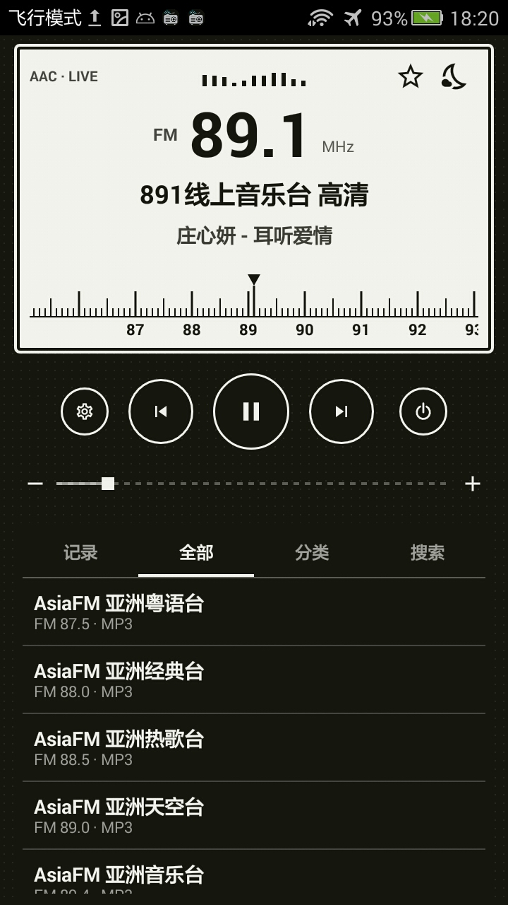
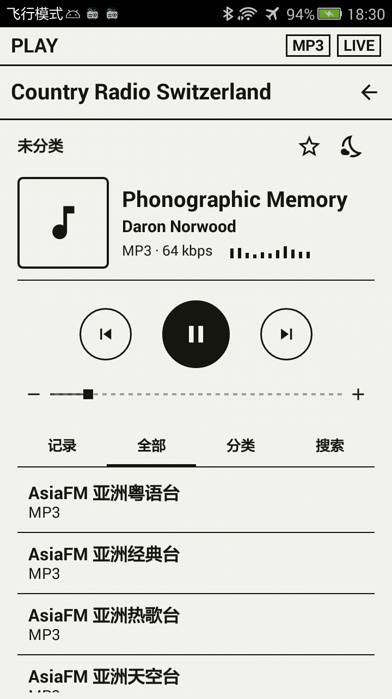
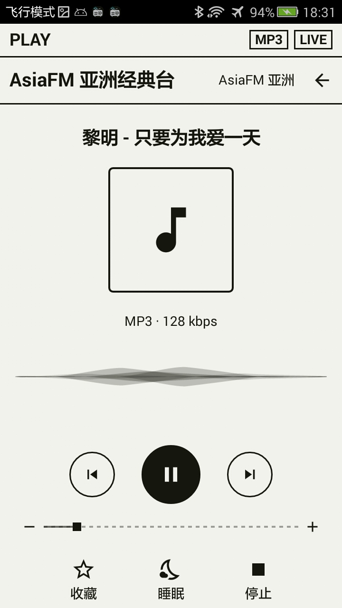
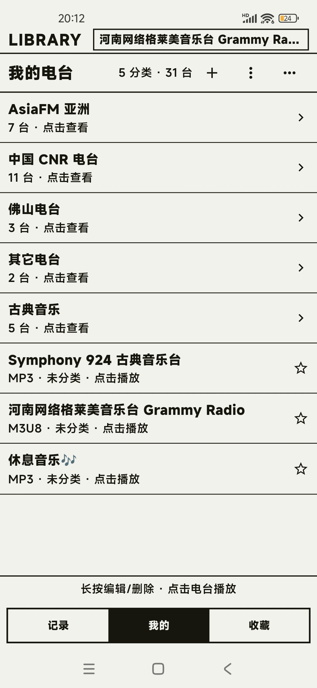
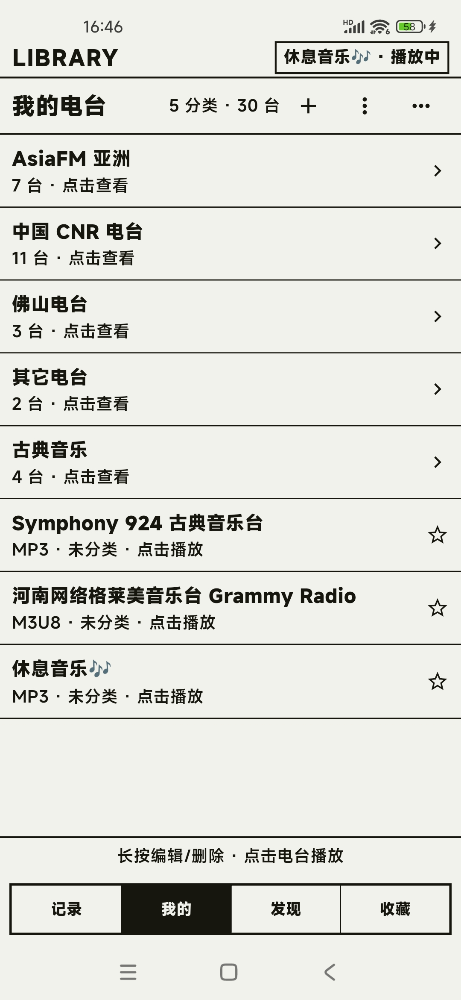
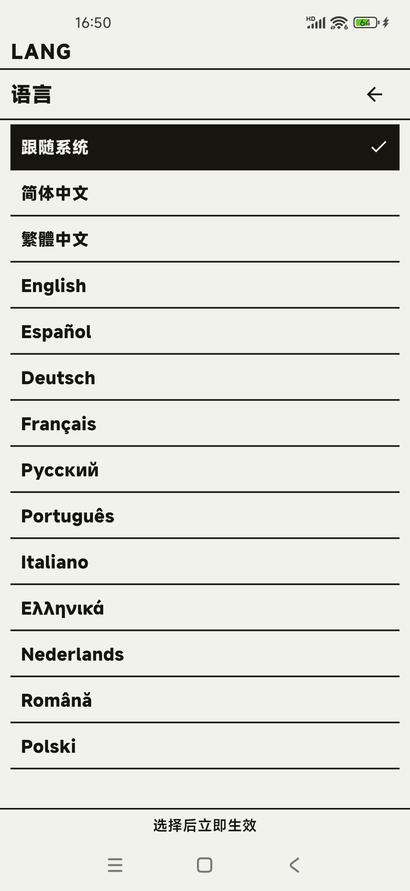
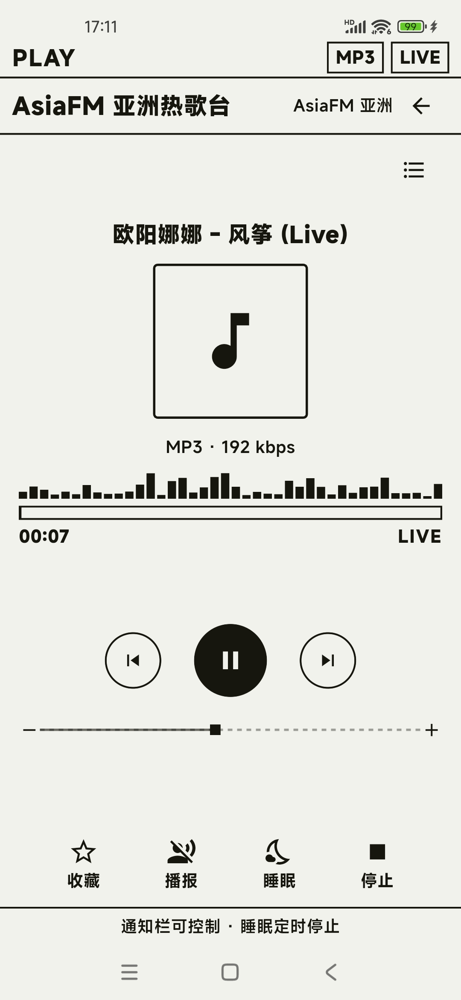

# Dingding Radio · TingTing Radio

**Internet Radio / Online Radio Player for Android** · Minimalist e-ink style · MP3 / M3U8 streams

[简体中文](README.md) · [繁體中文](README.zh-Hant.md) · [English](README.en.md)

Dingding Radio (TingTing Radio) is a minimalist, e-ink-style internet radio player for Android. MP3 and M3U8 (HLS) live streams play out of the box, playback continues with the screen off, and there is no account and no ads.

> This repository is for the app introduction, user guide and official APK releases only. **Source code is not included.**

<p align="center">
  
  
  
</p>

## Download

| Item | Details |
|---|---|
| Latest version | [v2026.11.21](https://github.com/haijiang2023/tingting-radio/releases/latest) |
| Package (recommended) | `01-ting-radio-android5-17_armeabi-v8a-2026.11.21.apk` (~22.3 MB) |
| Package (legacy devices) | `02-ting-radio-android4.x_armeabi-v7a-2026.11.21.apk` (~2.6 MB) |
| Requirements | **5.0 (API 21) – 17**: arm64-v8a; **4.x (API 17+)**: armeabi-v7a |
| Languages | Follow system + 14 languages: Simplified/Traditional Chinese, English, Español, Deutsch, Français, Русский, Português, Italiano, Ελληνικά, Nederlands, Română, Polski |
| Price | Free, no ads, no sign-in required |

**[⬇ Download the latest APK (GitHub Releases)](https://github.com/haijiang2023/tingting-radio/releases/latest)**

SHA-256 (v2026.11.21):

```
arm64-v8a / Android 5~17 (main build): E092518571A24F3E48CAAF4B5B6E73359D0C824AAC82AEB2E75151E4A3F2CEB9
armeabi-v7a / Android 4.x (legacy build): 4D32DE70BBB5DDF01410704B62DFF3487505853018865B087E9450C6BFFD2A2C
```

Verify the checksum after downloading, then install. If you are unsure, pick **arm64-v8a** — almost all phones released after 2018 support it.

## What's new (v2026.11.21)

1. **Two new player screens** — choose from 3 player layouts;
2. **Play directly from the History, My and Favorites pages** — no need to open the player screen;
3. Several small improvements and bug fixes.

## Features

- **MP3 & M3U8 support** — the stream format is detected from the URL automatically.
- **Keeps playing with the screen off** — foreground media service + wake lock; playback continues when locked or backgrounded.
- **Notification and lock-screen controls** — play, pause, previous, next, stop.
- **Your own station library** — add MP3 / M3U8 stations manually or bulk-import them from the clipboard; edit, move, delete, group, bulk-group and bulk-delete.
- **Favorites and resume** — star the stations you use and return to the last one on cold start.
- **Sleep timer** — stop automatically after 15 / 30 / 60 minutes.
- **Auto skip on failure** — when a stream fails, the app offers a clear message and tries the next station.
- **System volume sync** — the volume bar reads and writes Android media volume directly.
- **Multilingual interface** — follow system or manually pick one of 14 languages. Changes take effect immediately.
- **Paper-and-ink UI** — paper `#F2F2EC` + ink `#16160F`, inverted selection, no colors, gradients or shadows.

## Quick start

1. Download the APK from [Releases](https://github.com/haijiang2023/tingting-radio/releases/latest).
2. Allow “Install unknown apps” on your phone, then install it.
3. Open the app and tap `+` in the top-right corner. Enter a station name and its MP3 / M3U8 URL manually, or bulk-import stations from the clipboard.
4. Tap a station to play. Playback continues after you press the power button, and controls stay available in the notification shade.

Detailed guide (Simplified Chinese): [使用教程](docs/使用教程.md) · FAQ: [常见问题](docs/常见问题.md)

## Ways to add stations

| Method | Best for |
|---|---|
| Add manually | You already know an MP3 direct link or M3U8 URL and want to enter stations one by one |
| Bulk import from clipboard | You have copied several stream URLs and want to parse and import them at once |

You can create a group while adding a station. Groups are optional; the home screen shows a mixed list with groups on top and ungrouped stations below.

## Screenshots

<p align="center">
  <a href="screenshots/library.jpg"></a>
  <a href="screenshots/home.jpg"></a>
  <a href="screenshots/lang.jpg"></a>
  <a href="screenshots/player.jpg"></a>
</p>

<p align="center">
  My stations · History · Language (14) · Now playing
</p>

## About internet radio and online radio

Dingding Radio (TingTing Radio) is a free **internet radio** and **online radio** player for Android, also known as a streaming radio app or web radio client. It supports MP3 direct links and M3U8 (HLS) live streams, which makes it suitable for music stations, city stations and kids' radio programs. No account, no ads, and all your station data stays on your device.

## Notes

- No station directory or sample stations are built in. Add all stations yourself.
- You provide the stream URLs; third-party streams may expire or be region-restricted.
- Stations, groups, favorites and volume are stored on your device only. Uninstalling clears them.
- Two builds are published: **arm64-v8a (Android 5–17)** and **armeabi-v7a (Android 4.x)**. The app is not available on any app store.
- Source code is not provided. The app and this repository's content are copyrighted. The APK may be downloaded and installed for personal listening. Do not repackage, modify and redistribute it, or use it commercially.

Official website: <https://www.caicaiapp.com/radio/>

## Feedback

For bugs or feature requests, please open an [Issue](https://github.com/haijiang2023/tingting-radio/issues) and include your phone model, Android version, the station URL and steps to reproduce.

**Keywords**: internet radio, online radio, radio player, streaming radio, HLS radio, M3U8 radio, MP3 radio, Android radio app, free radio app, no ads, e-ink radio player, minimalist radio app, Chinese radio app.

中文關鍵字：網路電台、網路收音機、電台 App、線上廣播。中文关键词：网络电台、网络收音机、电台 App、在线广播。
