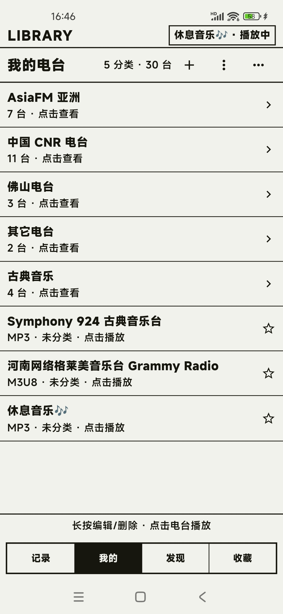
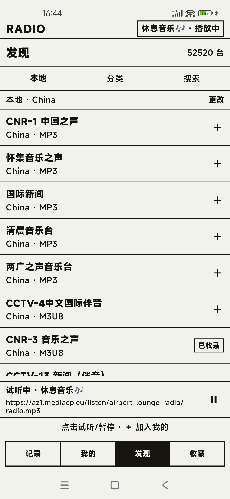
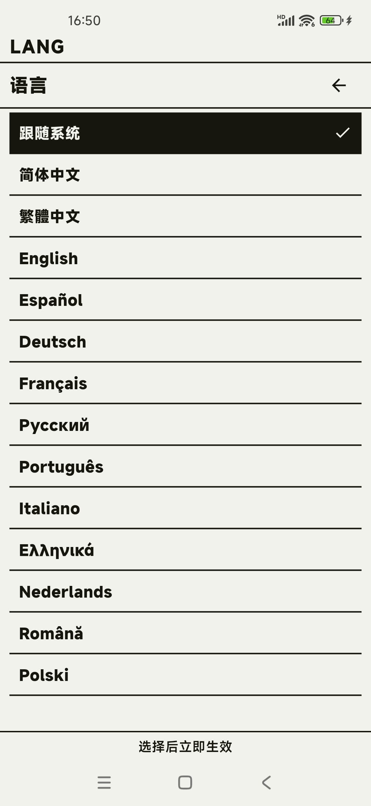

# 叮叮电台 · TingTing Radio

**Android 网络电台 / 网络收音机播放器** · 极简墨水屏风格 · MP3 / M3U8 直播流

[简体中文](README.md) · [繁體中文](README.zh-Hant.md) · [English](README.en.md)

叮叮电台是一款极简风仿墨水屏电子书界面的 Android 网络电台/收音机播放器APP：MP3 / M3U8 直播流开箱即播，息屏不断流，免登录、无广告。

> 本仓库仅用于发布应用介绍、使用教程和正式版 APK，**不包含源代码**。

<p align="center">
  
  
  
</p>

## 下载

| 项目 | 说明 |
|---|---|
| 最新版本 | [v2026.11.12](https://github.com/haijiang2023/tingting-radio/releases/latest) |
| 安装包（推荐） | `ding-radio-android5-17_armeabi-v8a-2026.11.12.apk`（约 21.6 MB） |
| 安装包（老设备） | `ding-radio-android4.x_armeabi-v7a-2026.11.12.apk`（约 2.6 MB） |
| 系统要求 | **5.0（API 21）~ 17**：arm64-v8a；**4.x（API 17+）**：armeabi-v7a |
| 语言 | 跟随系统 + 14 种语言：中（简/繁）、英、西、德、法、俄、葡、意、希、荷、罗、波 |
| 价格 | 免费，无广告，无需登录 |

**[⬇ 下载最新版 APK（GitHub Releases）](https://github.com/haijiang2023/tingting-radio/releases/latest)**

SHA-256（v2026.11.12）：

```
arm64-v8a / Android 5~17 主包：14C35644B667A8C290804CDF5C0CCC7987E9296046C9FAB36EFB82BE06228B7C
armeabi-v7a / Android 4.x 老包：9D04985AA516F3E290457688FE883CFCE70A228F18275B22E73B497043AC6F61
```

下载后可在系统里核对文件哈希，再安装。不确定选哪个的话，下载 **arm64-v8a** 即可（绝大多是 2018 年后的机型）。

## 更新说明（v2026.11.12）

1. **接入 RadioBrowser 公共电台库**，底部切到「发现」即可按本地 / 分类 / 搜索浏览全世界 **5.2 万+** 电台，点右侧 `+` 一键收藏；
2. **新增电台批量归类、批量删除**，整理自建电台库更高效；
3. **多语言界面**：跟随系统 + 14 种语言（简中、繁中、英、西、德、法、俄、葡、意、希、荷、罗、波），选择后立即生效；
4. 多项界面小改进与已知问题修复。

## 功能

- **MP3 / M3U8 双格式**：格式按链接自动判断，不用手选协议。
- **息屏不断流**：前台媒体服务 + 唤醒锁，锁屏、切后台继续播放。
- **通知栏 / 锁屏控制**：播放、暂停、上一台、下一台、停止。
- **自建电台库**：添加、编辑、移动、删除、分类、批量归类、批量删除；支持剪贴板批量导入与 RadioBrowser 在线电台库（5 万+）搜索。
- **收藏与续听**：收藏常用电台，冷启动回到上次收听。
- **睡眠定时**：15 / 30 / 60 分钟自动停止。
- **失败自动切台**：直播源失效时提示并自动尝试下一台。
- **音量双向对齐**：播放页音量条直接读写系统媒体音量。
- **多语言界面**：跟随系统或手动选择 14 种语言，切换立即生效。
- **纸墨界面**：纸感浅底 `#F2F2EC` + 墨黑 `#16160F`，选中反相，无彩色、渐变和阴影。

## 快速开始

1. 从 [Releases](https://github.com/haijiang2023/tingting-radio/releases/latest) 下载 APK。
2. 在手机上允许「安装未知来源应用」，点击安装。
3. 打开 App，底部切到「发现」，就能看到 **5.2 万+** 公共电台，按「本地 / 分类 / 搜索」浏览，点每行右侧 `+` 即可加入。
4. 点电台立即播放；按下电源键后声音继续，通知栏可直接控制。

完整说明见 [使用教程](docs/使用教程.md)，常见问题见 [常见问题](docs/常见问题.md)。

## 添加电台的方式

| 方式 | 适合场景 |
|---|---|
| **发现页 · RadioBrowser**（推荐） | 浏览 5 万+ 公共电台，按国家 / 分类 / 关键词搜索，点 `+` 即加 |
| 手动添加 | 已知 MP3 直链或 M3U8 地址 |
| 剪贴板批量导入 | 已复制多个台源链接，可批量解析 |

添加时可顺手新建分类。分类可以为 0 个，首页会以「分类在上、未分类在下」的混合列表展示。

## 界面

| | |
|---|---|
|  |  |
| 我的电台：分类计数与台源条目 | 发现页：RadioBrowser 5.2 万+ 电台，右侧 `+` 一键加入 |
| | |
|---|---|
|  |  |
| 语言：跟随系统 + 14 种语言，选择后立即生效 | 正在播放：纸墨界面 + 通知栏控制 |

## 关于「网络电台 / 网络收音机」

叮叮电台（TingTing Radio）是一款免费的 Android **网络电台**播放器，也常被称作**网络收音机**、在线广播 App、互联网电台客户端。它支持 MP3 直链与 M3U8（HLS）直播流，适合收听音乐电台、城市电台、少儿电台等广播节目；免登录、无广告，电台与收藏数据只保存在本机。

## 说明

- 应用内置部分示例台；其余电台由你自行添加。
- 电台源由你自己录入，第三方转流地址可能失效或受地域限制。
- 电台、分类、收藏、音量等数据只保存在本机，不需要账号；卸载会一并清除。
- 同时发布 **arm64-v8a（Android 5~17）** 与 **armeabi-v7a（Android 4.x）** 两个版本，未上架任何应用商店。
- 本仓库不提供源码；应用与文案版权归作者所有，APK 可免费下载安装用于个人收听，请勿二次打包、修改后分发或用于商业用途。

官方网站：<https://www.caicaiapp.com/radio/>

## 反馈

遇到问题或有功能建议，请在本仓库的 [Issues](https://github.com/haijiang2023/tingting-radio/issues) 中反馈，并尽量附上：机型、系统版本、电台地址、复现步骤。

**关键词**：网络电台、网络收音机、网络收音机 App、电台 App、收音机 App、在线广播、互联网电台、直播流电台、MP3 电台、M3U8 电台、HLS 电台、Android 电台播放器、墨水屏风格电台、免费无广告电台。

English keywords: internet radio, online radio, radio player, streaming radio, HLS radio, M3U8 radio, MP3 radio, Android radio app, free radio app, no ads.
