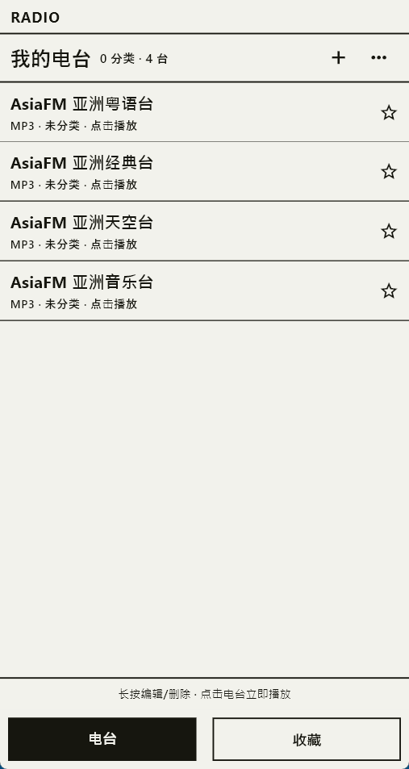
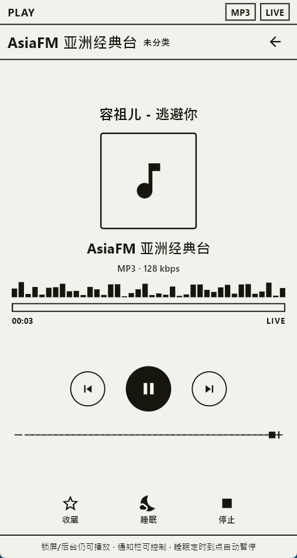
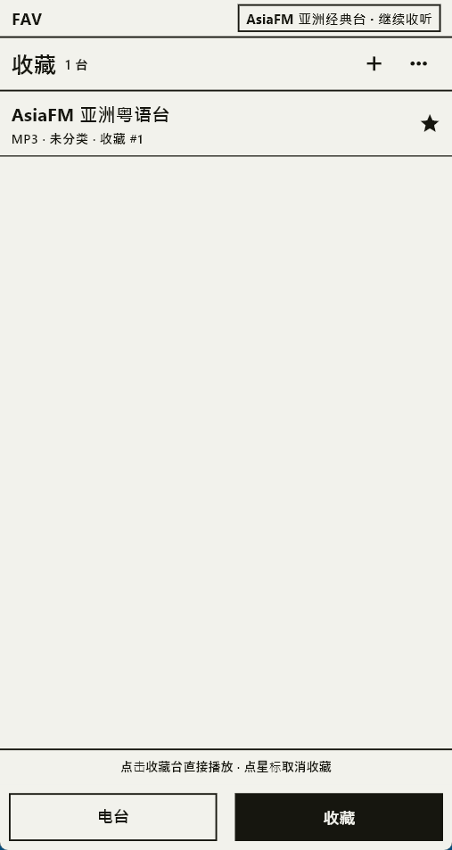
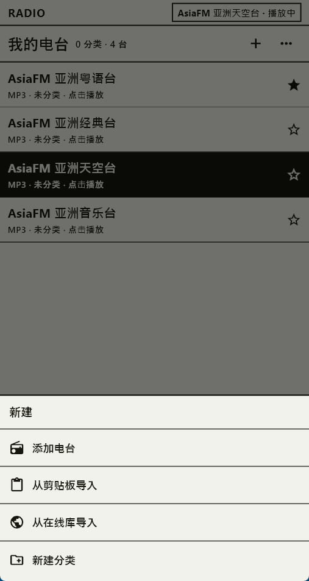

# 叮叮电台 · TingTing Radio

一款「纸墨风」的 Android 网络电台播放器：MP3 / M3U8 直播流开箱即播，息屏不断流，免登录、无广告，界面只有纸和墨。

> 本仓库仅用于发布应用介绍、使用教程和正式版 APK，**不包含源代码**。

<p align="center">
  
  
  
</p>

## 下载

| 项目 | 说明 |
|---|---|
| 最新版本 | [v2026.11.3](https://github.com/haijiang2023/tingting-radio/releases/latest) |
| 安装包 | `dingding-radio-2026.11.3.apk`（约 21 MB） |
| 系统要求 | Android 5.0（API 21）及以上，**arm64-v8a** 设备 |
| 语言 | 简体中文 / 繁體中文 / English |
| 价格 | 免费，无广告，无需登录 |

**[⬇ 下载最新版 APK](https://github.com/haijiang2023/tingting-radio/releases/latest)**

SHA-256（v2026.11.3）：

```
2A789F628A766CF767158677FADEE621D7EEBE839019123CBC62AF21D3368FF8
```

下载后可在系统里核对文件哈希，再安装。

## 功能

- **MP3 / M3U8 双格式**：格式按链接自动判断，不用手选协议。
- **息屏不断流**：前台媒体服务 + 唤醒锁，锁屏、切后台继续播放。
- **通知栏 / 锁屏控制**：播放、暂停、上一台、下一台、停止。
- **自建电台库**：添加、编辑、移动、删除、分类；支持剪贴板批量导入与在线电台库搜索。
- **收藏与续听**：收藏常用电台，冷启动回到上次收听。
- **睡眠定时**：15 / 30 / 60 分钟自动停止。
- **失败自动切台**：直播源失效时提示并自动尝试下一台。
- **音量双向对齐**：播放页音量条直接读写系统媒体音量。
- **纸墨界面**：纸感浅底 `#F2F2EC` + 墨黑 `#16160F`，选中反相，无彩色、渐变和阴影。

## 快速开始

1. 从 [Releases](https://github.com/haijiang2023/tingting-radio/releases/latest) 下载 APK。
2. 在手机上允许「安装未知来源应用」，点击安装。
3. 打开 App，点击首页右上角 `+` 添加电台：可手动填写，也可从剪贴板或在线电台库导入。
4. 点击电台立即播放；按下电源键后声音继续，通知栏可直接控制。

完整说明见 [使用教程](docs/使用教程.md)，常见问题见 [常见问题](docs/常见问题.md)。

## 添加电台的三种方式

| 方式 | 适合场景 |
|---|---|
| 手动添加 | 已知 MP3 直链或 M3U8 地址 |
| 从剪贴板导入 | 已复制多个台源链接，可批量解析 |
| 从在线库导入 | 搜索公共电台目录，一键添加 |

添加时可顺手新建分类。分类可以为 0 个，首页会以「分类在上、未分类在下」的混合列表展示。

## 界面

| | |
|---|---|
|  |  |
| 我的电台：分类计数与台源条目 | 新建：手动 / 剪贴板 / 在线库 / 新建分类 |

## 说明

- 应用不内置大规模电台目录，首启仅有 4 个 AsiaFM 示例台；其余电台由你自行添加。
- 电台源由你自己录入，第三方转流地址可能失效或受地域限制。
- 电台、分类、收藏、音量等数据只保存在本机，不需要账号；卸载会一并清除。
- 当前仅发布 Android arm64 版本，未上架任何应用商店。
- 本仓库不提供源码；应用与文案版权归作者所有，APK 可免费下载安装用于个人收听，请勿二次打包、修改后分发或用于商业用途。

官方网站：<https://www.caicaiapp.com/radio/index.html>

## 反馈

遇到问题或有功能建议，请在本仓库的 [Issues](https://github.com/haijiang2023/tingting-radio/issues) 中反馈，并尽量附上：机型、系统版本、电台地址（可脱敏）、复现步骤。
