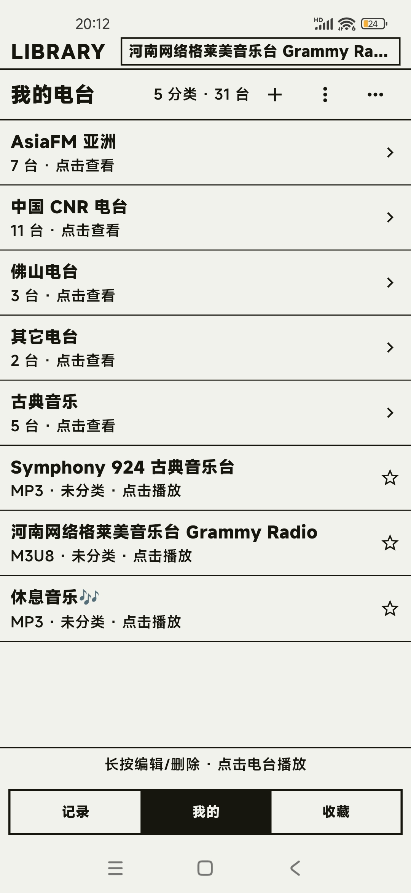
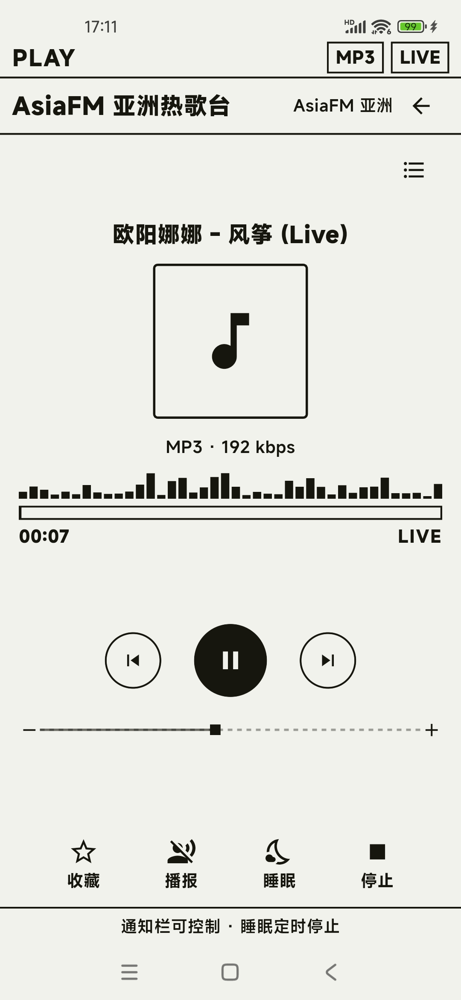
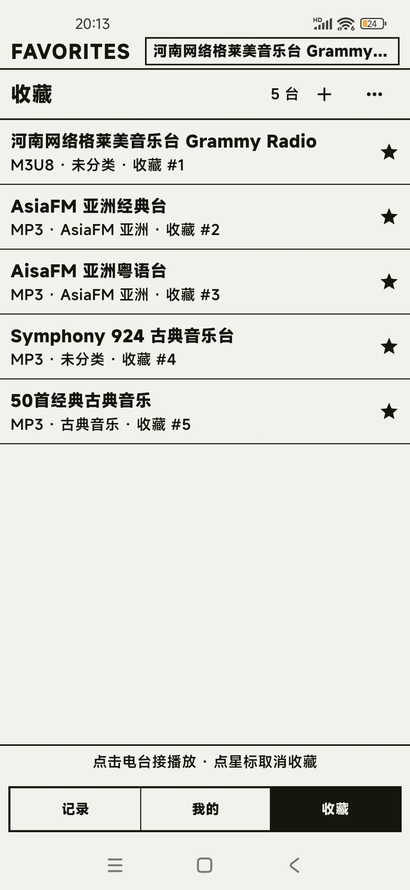
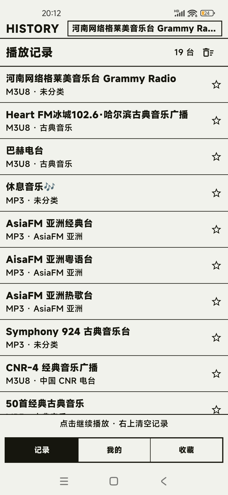
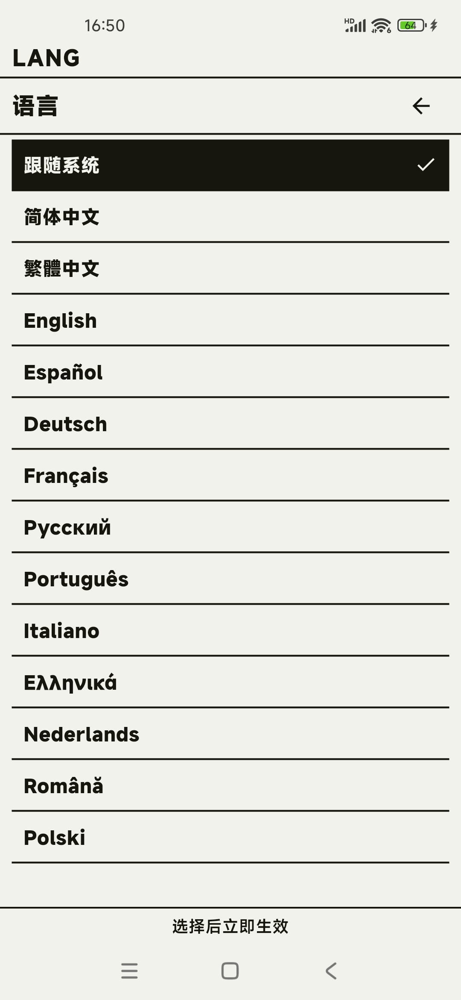

# 叮叮電台 · TingTing Radio

**Android 網路電台 / 網路收音機播放器** · 極簡墨水屏風格 · MP3 / M3U8 直播串流

[简体中文](README.md) · [繁體中文](README.zh-Hant.md) · [English](README.en.md)

叮叮電台是一款極簡風仿墨水屏電子書介面的 Android 網路電台/收音機播放器 APP：MP3 / M3U8 直播串流開箱即播，螢幕關閉不斷流，免登入、無廣告。

> 本倉庫僅用於發布應用介紹、使用教學與正式版 APK，**不包含原始碼**。

<p align="center">
  
  
  
</p>

## 下載

| 項目 | 說明 |
|---|---|
| 最新版本 | [v2026.11.12](https://github.com/haijiang2023/tingting-radio/releases/latest) |
| 安裝包（推薦） | `01-ding-radio-android5-17_armeabi-v8a-2026.11.12.apk`（約 21.6 MB） |
| 安裝包（舊裝置） | `02-ding-radio-android4.x_armeabi-v7a-2026.11.12.apk`（約 2.6 MB） |
| 系統需求 | **5.0（API 21）~ 17**：arm64-v8a；**4.x（API 17+）**：armeabi-v7a |
| 語言 | 跟隨系統 + 14 種語言：中（簡/繁）、英、西、德、法、俄、葡、意、希、荷、羅、波 |
| 價格 | 免費、無廣告、免登入 |

**[⬇ 下載最新版 APK（GitHub Releases）](https://github.com/haijiang2023/tingting-radio/releases/latest)**

SHA-256（v2026.11.12）：

```
arm64-v8a / Android 5~17 主包：14C35644B667A8C290804CDF5C0CCC7987E9296046C9FAB36EFB82BE06228B7C
armeabi-v7a / Android 4.x 舊包：9D04985AA516F3E290457688FE883CFCE70A228F18275B22E73B497043AC6F61
```

下載後可在系統中核對檔案雜湊值，再進行安裝。不確定選哪個的話，下載 **arm64-v8a** 即可（2018 年後的機型幾乎都支援）。

## 更新說明（v2026.11.12）

1. **新增電台批次歸類、批次刪除**，整理自建電台庫更高效；
2. **多語言介面**：跟隨系統 + 14 種語言（簡中、繁中、英、西、德、法、俄、葡、意、希、荷、羅、波），選擇後立即生效；
3. 多項介面小改進與已知問題修復。

## 功能

- **MP3 / M3U8 雙格式**：依連結自動判斷格式，不需手動選擇協定。
- **螢幕關閉不斷流**：前景媒體服務 + 喚醒鎖，鎖定畫面、切到背景都能繼續播放。
- **通知列 / 鎖定畫面控制**：播放、暫停、上一台、下一台、停止。
- **自建電台庫**：手動新增或從剪貼簿批次匯入 MP3 / M3U8 電台；支援編輯、移動、刪除、分類、批次歸類、批次刪除。
- **收藏與續聽**：收藏常用電台，冷啟動回到上次收聽。
- **睡眠定時**：15 / 30 / 60 分鐘後自動停止。
- **失敗自動切台**：直播源失效時提示並自動嘗試下一台。
- **音量雙向對齊**：播放頁音量列直接讀寫系統媒體音量。
- **多語言介面**：跟隨系統或手動選擇 14 種語言，切換立即生效。
- **紙墨介面**：紙感淺底 `#F2F2EC` + 墨黑 `#16160F`，選取反相，無彩色、漸層和陰影。

## 快速開始

1. 從 [Releases](https://github.com/haijiang2023/tingting-radio/releases/latest) 下載 APK。
2. 在手機上允許「安裝未知來源應用程式」，點擊安裝。
3. 開啟 App，點擊首頁右上角 `+`，手動填寫電台名稱與 MP3 / M3U8 位址，或從剪貼簿批次匯入。
4. 點擊電台立即播放；按下電源鍵後聲音繼續，通知列可直接控制。

完整說明見 [使用教學（簡體中文）](docs/使用教程.md)，常見問題見 [常見問題（簡體中文）](docs/常见问题.md)。

## 新增電台的方式

| 方式 | 適合情境 |
|---|---|
| 手動新增 | 已知 MP3 直鏈或 M3U8 位址，逐個填寫電台名稱與連結 |
| 剪貼簿批次匯入 | 已複製多個台源連結，可一次性解析匯入 |

新增時可順手建立分類。分類可以為 0 個，首頁會以「分類在上、未分類在下」的混合清單呈現。

## 介面

<p align="center">
  <a href="screenshots/library.jpg"></a>
  <a href="screenshots/home.jpg"></a>
  <a href="screenshots/lang.jpg"></a>
  <a href="screenshots/player.jpg"></a>
</p>

<p align="center">
  我的電台 · 播放記錄 · 語言設定（14 種）· 正在播放
</p>

## 關於「網路電台 / 網路收音機」

叮叮電台（TingTing Radio）是一款免費的 Android **網路電台**播放器，也常被稱作**網路收音機**、線上廣播 App、網際網路電台客戶端。支援 MP3 直鏈與 M3U8（HLS）直播串流，適合收聽音樂電台、城市電台、兒童電台等廣播節目；免登入、無廣告，電台與收藏資料只保存在本機。

## 說明

- 應用程式不內建電台目錄或範例台，所有電台均需由你自行新增。
- 電台源由你自行輸入，第三方轉流位址可能失效或受地區限制。
- 電台、分類、收藏、音量等資料只保存在本機，不需要帳號；解除安裝會一併清除。
- 同時發布 **arm64-v8a（Android 5~17）** 與 **armeabi-v7a（Android 4.x）** 兩個版本，未上架任何應用程式商店。
- 本倉庫不提供原始碼；應用程式與文案版權歸作者所有，APK 可免費下載安裝供個人收聽，請勿二次打包、修改後散布或用於商業用途。

官方網站：<https://www.caicaiapp.com/radio/>

## 意見回饋

遇到問題或有功能建議，請在本倉庫的 [Issues](https://github.com/haijiang2023/tingting-radio/issues) 中回報，並盡量附上：機型、系統版本、電台位址、重現步驟。

**關鍵字**：網路電台、網路收音機、網路收音機 App、電台 App、收音機 App、線上廣播、網際網路電台、直播串流電台、MP3 電台、M3U8 電台、HLS 電台、Android 電台播放器、墨水屏風格電台、免費無廣告電台。

English keywords: internet radio, online radio, radio player, streaming radio, HLS radio, M3U8 radio, MP3 radio, Android radio app, free radio app, no ads.
